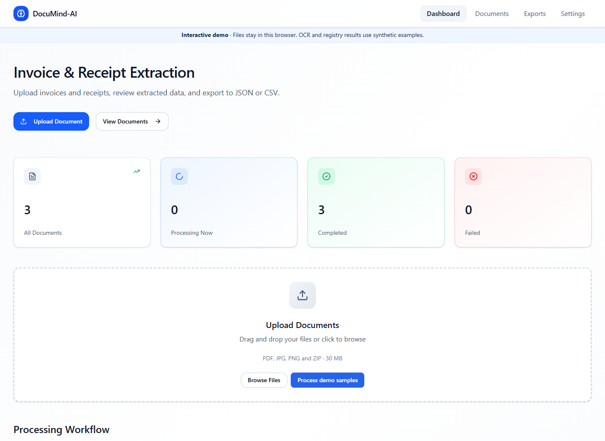
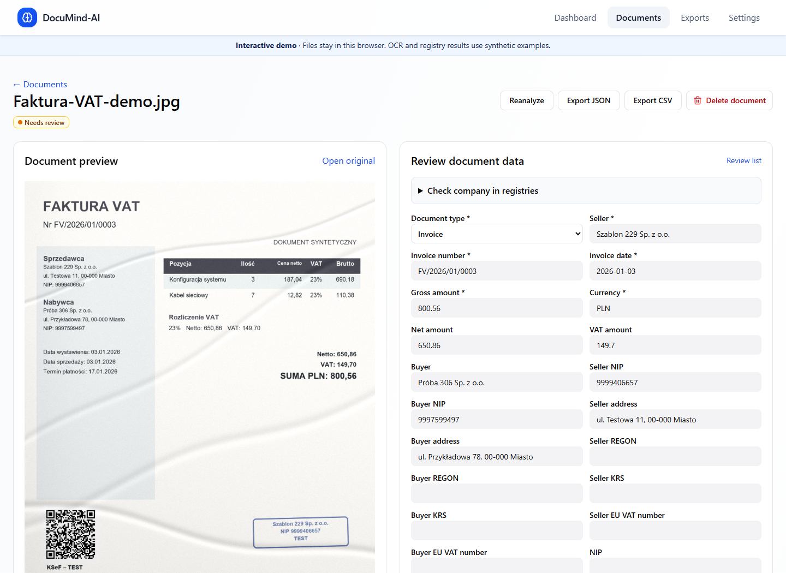
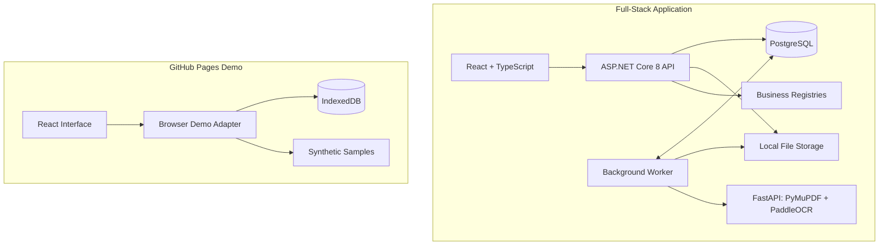
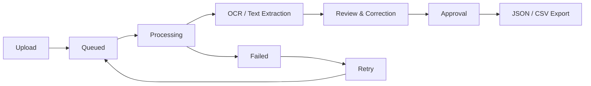

<p align="center">
  
</p>

<h1 align="center">DocuMind AI</h1>

<p align="center">
  <strong>Turn invoices and receipts into structured, reviewable data.</strong>
</p>

<p align="center">
  <a href="https://avuii.github.io/DocuMind-AI/">
    
  </a>
  <a href="https://github.com/Avuii/DocuMind-AI/actions/workflows/ci.yml">
    
  </a>
</p>

<p align="center">
  
  
  
  
  
</p>

<p align="center">
  <a href="https://avuii.github.io/DocuMind-AI/"><strong>Live Demo</strong></a> ·
  <a href="#getting-started"><strong>Getting Started</strong></a> ·
  <a href="https://github.com/Avuii/DocuMind-AI/issues"><strong>Report an Issue</strong></a>
</p>

---

## Application Preview

| Dashboard | Document Review |
|:---:|:---:|
| [](docs/demo-dashboard.png) | [](docs/demo-document.png) |

## Table of Contents

- [Overview](#overview)
- [Key Features](#key-features)
- [Technology Stack](#technology-stack)
- [Architecture](#architecture)
- [Getting Started](#getting-started)
- [Configuration & API](#configuration--api)
- [Testing & Security](#testing--security)
- [Production Deployment](docs/production.md)
- [Project Status & Roadmap](#project-status--roadmap)
- [License](#license)
- [Author](#author)

## Overview

**DocuMind AI** is a document intelligence application for processing invoices and receipts. It combines PDF text extraction and OCR with a human-in-the-loop review workflow, allowing users to check extracted values against the original document before exporting structured data.

The full-stack application provides account management, document processing, PostgreSQL persistence, and integrations with business registries. An independent browser-based demo is available on GitHub Pages.

### Try the Live Demo

<p align="center">
  <a href="https://avuii.github.io/DocuMind-AI/"><strong>Open DocuMind AI on GitHub Pages →</strong></a>
</p>

Open an example in **Documents**, or select **Process demo samples** on the dashboard. You can inspect extracted fields, correct values, ask questions with source quotes, organize records into colored groups, and export approved results as JSON or CSV.

> [!NOTE]
> The GitHub Pages demo runs without an account and stores changes in the browser. OCR and registry responses for its bundled synthetic samples are simulated. Other PDFs and images can be previewed and reviewed manually; real OCR, registry calls, and account management require the full application.

The demo also supports English and Polish, browser-supported export-folder selection, and resetting local demo data in **Settings**.

## Key Features

| Feature | Description |
|---|---|
| **Document Upload** | Import PDF, JPG, PNG, or ZIP files and monitor processing batches. |
| **OCR & Extraction** | Read embedded PDF text or process scans and photos, extracting dates, counterparties, tax identifiers, totals, and supported line items. |
| **Review & Approval** | Compare extracted fields with document previews, correct inaccurate values, and approve records for export. |
| **Document Q&A** | Ask questions in Polish or English and inspect supporting source lines. |
| **Counterparty Verification** | Compare identifiers against VAT White List, KRS, VIES, and optionally GUS REGON or CEIDG. |
| **Organization** | Filter by status, apply tags, and manage named groups with custom colors. |
| **Export** | Export individual records or approved batches to JSON and CSV. |
| **Localization** | Switch between English and Polish in the interface. |

> [!TIP]
> Review extracted totals, currencies, dates, and tax identifiers against the original before exporting. OCR quality depends on scan readability and document layout.

## Technology Stack

| Layer | Technologies |
|---|---|
| **Frontend** | React, TypeScript, Vite |
| **Backend API** | C#, ASP.NET Core 8, ASP.NET Core Identity |
| **Document Processing** | Python, FastAPI, PyMuPDF, PaddleOCR |
| **Database** | PostgreSQL 16 |
| **Browser Demo** | IndexedDB, browser storage |
| **Infrastructure** | Docker, Docker Compose |
| **CI/CD** | GitHub Actions, GitHub Pages |
| **Test Data** | Python-based synthetic document generator |

## Architecture

The full application separates the frontend, API, background processing, and persistence. The public demo runs the React interface using a browser adapter instead of backend services.



### Document Processing Flow



### Repository Structure

| Location | Purpose |
|---|---|
| [`frontend/`](frontend/) | React UI, translations, and browser-based demo |
| [`backend/`](backend/) | ASP.NET Core API, authentication, background worker, and registry integrations |
| [`ml-service/`](ml-service/) | OCR, PDF parsing, and structured extraction |
| [`scripts/`](scripts/) | Synthetic invoice and receipt generator |
| [`tests/`](tests/) | Document API smoke tests |
| [`docs/`](docs/) | Interface screenshots and supporting documentation |
| [`.github/workflows/`](.github/workflows/) | CI checks and GitHub Pages deployment |
| [`docker-compose.yml`](docker-compose.yml) | Local PostgreSQL, API, and OCR services |

## Getting Started

### Prerequisites

- **Docker** with Docker Compose
- **Node.js 22** and npm
- **Git**

### Installation

Clone the repository and start the local services:

```bash
git clone https://github.com/Avuii/DocuMind-AI.git
cd DocuMind-AI
docker compose up --build -d
```

Start the frontend in a separate terminal:

```bash
cd frontend
npm ci
npm run dev
```

### Local Addresses

| Service | Address |
|---|---|
| **Frontend** | [http://localhost:4000](http://localhost:4000) |
| **Backend API** | [http://localhost:5000](http://localhost:5000) |
| **Swagger (Development)** | [http://localhost:5000/swagger](http://localhost:5000/swagger) |

The OCR service may need additional time on first startup while downloading its models.

### First-Time Account Setup

Create a local account using a password of at least **12 characters**, including uppercase and lowercase letters, a number, and a special character. Generate and save a recovery code in **Settings** for password recovery.

### Run the Browser Demo Locally

No Docker services or account are required for the demo:

```bash
cd frontend
npm ci
npm run dev:demo
```

## Configuration & API

### Environment Variables

| Variable | Location | Purpose |
|---|---|---|
| `DOCUMIND_API_URL` | `frontend/.env.local` | Override the Vite proxy target for the backend; default is `http://127.0.0.1:5000`. |
| `DOCUMIND_GUS_KEY` | Root `.env` | Enable GUS REGON queries. |
| `DOCUMIND_CEIDG_TOKEN` | Root `.env` | Enable CEIDG queries using a JWT without the `Bearer` prefix. |

VAT White List, KRS, and VIES use public services. After changing GUS or CEIDG environment values, recreate the backend container:

```bash
docker compose up -d --force-recreate backend
```

> [!IMPORTANT]
> Do not commit real API keys, registry tokens, account credentials, or uploaded business documents. The Docker Compose configuration is intended for **local development**, not a production deployment.

### API Reference

The ASP.NET Core API supports account management, document uploads, processing status, extraction results, review actions, and export. The interactive API reference is available through [Swagger](http://localhost:5000/swagger) when the backend runs in Development mode.

## Testing & Security

### API Smoke Tests

With Docker Compose running, execute the document API smoke tests from the repository root using **PowerShell 7**:

```powershell
./tests/document-api.ps1 -IncludeOcr
```

### OCR Evaluation

With the OCR service running, compare extracted fields with synthetic ground truth across sidebar and framed invoices, a thermal receipt, a scanned PDF, and a two-page text PDF.

```bash
python tests/ocr-eval.py --report test-results/ocr.json
```

Use `--dataset datasets/Generated` to include generated documents and measure accuracy by field and layout. The report records matches and counts without copying document text. The bundled cases enforce regression checks on selected fields and page positions.

### Registry Integration Tests

```bash
dotnet run --project tests/RegistryIntegration --configuration Release
```

The suite exercises the production registry client against simulated HTTP and SOAP responses, including missing credentials, conflicting identifiers, rate limits, malformed payloads, and cancellation. The API smoke test also checks endpoint authorization and identifier validation.

### Frontend Build Checks

```bash
cd frontend
npm ci
npm run build
npm run build:demo
```

`npm run build:demo` generates the static demo in `frontend/dist-demo/`.

### Continuous Integration & Deployment

The [CI workflow](.github/workflows/ci.yml) builds both frontend modes, rejects tracked files that violate `.gitignore`, and runs the API, OCR evaluation, and registry tests.

The [GitHub Pages workflow](.github/workflows/deploy-frontend-pages.yml) builds and publishes the static demo from `main`. The repository must use **Settings → Pages → Build and deployment → Source: GitHub Actions**.

For the full application, follow the [production deployment guide](docs/production.md).

### Synthetic Test Data

Create synthetic invoices and receipts with Python:

```bash
python -m pip install -r scripts/requirements-generated.txt
python scripts/generate_documents.py --language pl en de --invoices 8 --receipts 8 --degradation mixed
```

The generator writes sample images and paired `ground_truth` JSON files to `datasets/Generated`. Labels include typed field values, tax totals, line items, and text coordinates. Invoice samples contain test stamps and KSeF-style QR codes using an intentionally invalid domain.

### Data & Privacy

| Environment | Storage and processing |
|---|---|
| **Full application** | Original files are stored in `backend/storage/`; account and extraction records are stored in PostgreSQL. |
| **GitHub Pages demo** | Uses bundled synthetic samples and browser-local storage; it does not send documents to the full-stack API. |
| **Repository** | Local uploads, datasets, credentials, exports, and build artifacts are excluded from Git. |

> [!WARNING]
> OCR output may contain incorrect or incomplete values. Verify extracted data before using it for accounting, reporting, or other consequential decisions.

## Project Status & Roadmap

**Current status: Active development.** The interactive demo runs on GitHub Pages. The full stack has local and single-host production configurations.

### Implemented

- [x] React interface with English and Polish localization.
- [x] Interactive GitHub Pages demo with synthetic samples and browser persistence.
- [x] PDF, image, and ZIP upload with document queue and status tracking.
- [x] PDF text extraction and PaddleOCR processing in the full application.
- [x] Document review, inline corrections, approval, and source-linked Q&A.
- [x] Business registry integrations with optional GUS REGON and CEIDG configuration.
- [x] Tags, colored groups, filters, and JSON/CSV export.
- [x] ASP.NET Core account management and password recovery workflow.
- [x] PostgreSQL persistence and background document processing.
- [x] Synthetic document generator and automated API smoke tests with OCR in CI.
- [x] Automated static demo deployment through GitHub Pages.

- [x] Layout-based OCR regression coverage and field accuracy reports.
- [x] Deterministic registry tests with simulated providers.
- [x] Single-host deployment guidance, proxy trust and health probes.

## License

Copyright © 2026 [Avuii](https://github.com/Avuii). All rights reserved.

The project's original code, design, and content may not be copied,
modified, redistributed, or used commercially without prior written
permission, except where applicable law permits.

Previously released MIT-licensed versions remain covered by their original license.

Third-party materials retain their respective licenses.
See the [LICENSE](LICENSE) file for details.

---

## Author

Created and maintained by **[Avuii](https://github.com/Avuii)**.
