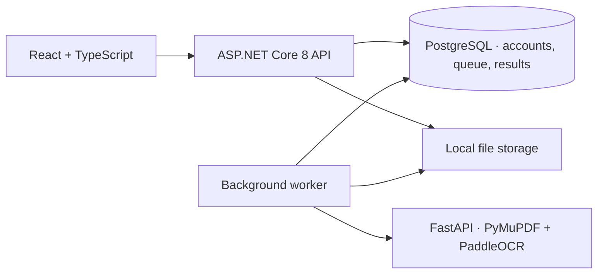

<p align="center">
  
</p>

<h1 align="center">DocuMind AI</h1>

<p align="center">
  <strong>Turn invoices and receipts into structured, reviewable data.</strong>
</p>

<p align="center">
  <a href="https://avuii.github.io/DocuMind-AI/"></a>
  <a href="https://github.com/Avuii/DocuMind-AI/actions/workflows/ci.yml"></a>
  <a href="LICENSE"></a>
  <br />
  
  
  
  
  
</p>

---

## Contents

[Live demo](#live-demo) · [Interface preview](#interface-preview) · [Features](#features) · [Architecture](#architecture) · [Run locally](#run-locally) · [Testing and deployment](#testing-and-deployment) · [Synthetic dataset](#synthetic-dataset) · [Data and privacy](#data-and-privacy)

## Live demo

**[Open DocuMind AI on GitHub Pages →](https://avuii.github.io/DocuMind-AI/)**

Open an example from **Documents**, or select **Process demo samples** on the dashboard to try the upload queue. Review fields alongside the original, ask a question with a source quote, assign a colored group, and export approved results to JSON or CSV.

The demo uses the same React screens as the full app. It starts without an account and keeps your edits and uploads in your browser. OCR and registry results are simulated for the included synthetic samples. Other PDFs and images can be previewed and filled in manually. Real OCR, registry queries, and account management are available when you run the full application. In **Settings**, choose English or Polish, set an export folder when supported, or reset the demo.

## Interface preview

| Dashboard | Document review |
| --- | --- |
| [](docs/demo-dashboard.png) | [](docs/demo-document.png) |

## Features

- **Upload and track:** Add PDFs, JPGs, PNGs, or a ZIP. Follow the current batch, cancel pending processing, retry a document, or delete it from history.
- **Extract:** Read embedded PDF text or run OCR on scans and photos. Detect invoice or receipt and document language, and extract dates, parties, tax identifiers, totals, and supported line items.
- **Review:** Compare extracted fields with the original, correct missing or inaccurate values, and approve records for bulk export. Ask questions in Polish or English and see the source lines.
- **Verify counterparties:** Compare identifiers with the VAT White List, KRS, VIES, GUS REGON, or CEIDG where configured. Choose which registry values to apply.
- **Organize and export:** Use tags, named groups with custom colors, and status filters. Export individual or approved documents to JSON or CSV.

## Architecture



The Pages build replaces API calls with a browser adapter backed by IndexedDB. The regular build uses the API for authentication, persistence, and extraction.

| Location | Purpose |
| --- | --- |
| [frontend/](frontend/) | React UI, English and Polish translations, browser demo |
| [backend/](backend/) | ASP.NET Core API, Identity, background worker and registry integrations |
| [ml-service/](ml-service/) | PDF parsing, OCR and structured extraction |
| [scripts/](scripts/) | Synthetic invoice and receipt generator |
| [tests/](tests/) | API smoke tests |
| [.github/workflows/](.github/workflows/) | CI and GitHub Pages deployment |

## Run locally

Requires Docker with Compose and Node.js 22.

```sh
docker compose up --build -d
cd frontend
npm ci
npm run dev
```

Open [localhost:4000](http://localhost:4000). The API is on port 5000 and [Swagger](http://localhost:5000/swagger) is available in development. The OCR service may take a few minutes on its first run while models download. Use `DOCUMIND_API_URL` in `frontend/.env.local` to point Vite at a different API.

Create a local account with at least 12 characters in the password, including uppercase and lowercase letters, a digit, and a special character. In Settings, generate and save a recovery code before you need to reset your password.

The VAT White List, KRS, and VIES use public services. To enable GUS REGON or CEIDG, set `DOCUMIND_GUS_KEY` or `DOCUMIND_CEIDG_TOKEN` in a local `.env` file and recreate the backend container. Supply the CEIDG JWT without the `Bearer` prefix.

## Testing and deployment

From the repository root, run the API smoke test with PowerShell 7 and Compose running:

```powershell
./tests/document-api.ps1 -IncludeOcr
```

Run the static demo locally without Compose:

```sh
cd frontend
npm ci
npm run dev:demo
```

`npm run build:demo` writes only the static site to `frontend/dist-demo/`. The [Pages workflow](.github/workflows/deploy-frontend-pages.yml) builds this directory and publishes it from `main`. The repository's **Settings → Pages → Source** must be set to **GitHub Actions**. CI also builds both frontend modes and rejects tracked files that match `.gitignore`.

## Synthetic dataset

```sh
python -m pip install -r scripts/requirements-generated.txt
python scripts/generate_documents.py --language pl en de --invoices 8 --receipts 8 --degradation mixed
```

The generator writes images and paired `ground_truth` JSON to `datasets/Generated`. The labels contain typed values, tax totals, line items, and text coordinates. Invoices have test stamps and KSeF-style QR codes pointing to a deliberately invalid domain. Use a different seed to generate another set.

## Data and privacy

The full app stores originals under `backend/storage/` and results in PostgreSQL. The public demo bundles only the explicitly included synthetic samples. Files you open in the demo stay in your browser. Local uploads, datasets, credentials, exports, and build output are excluded from Git; use the listed synthetic fixture paths for material meant to be public.

Extraction quality depends on image readability and document layout. Review values before export, particularly when a scan is faint, fields are missing, or currencies conflict.

## License

[MIT](LICENSE) · Created by [Avuii](https://github.com/Avuii).
